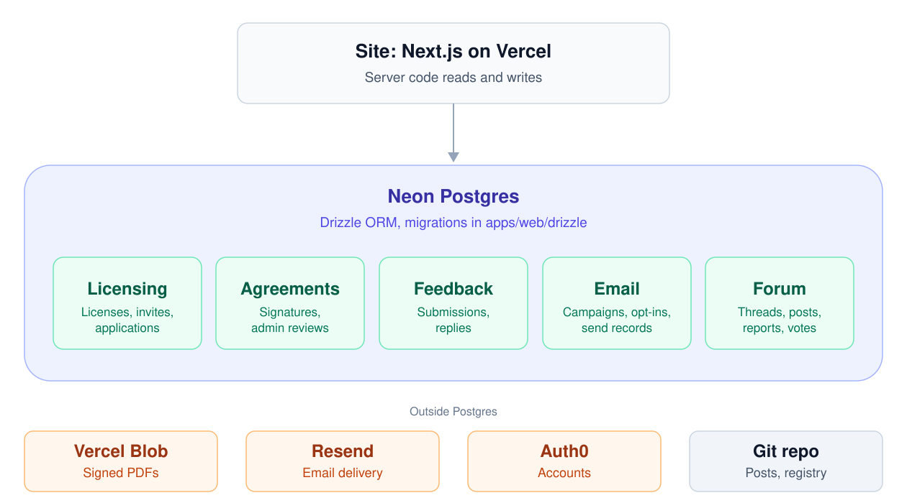

# Astrea Labs


## ⚡ Quickstart & Developer Workflow

Modeled after `KingMoonk/TRAINER` with a root `Makefile`:

```bash
# 1. Install dependencies
make setup          # or: pnpm install

# 2. Start local development server
make dev            # starts apps/web on http://localhost:3000

# 3. Run typecheck across all workspaces
make typecheck

# 4. Run linter
make lint

# 5. Run Vitest unit & component tests
make test

# 6. Build all workspaces with Turborepo
make build

# 7. Run Playwright end-to-end tests
make test-e2e
```

## 📚 Data Model 



## 🔄 CI/CD Pipelines (GitHub Actions)

Derived from the battle-tested pipeline in `KingMoonk/TRAINER`:
- **`ci.yml`**:
  - **Lint & Typecheck**: Parallel verification with `pnpm lint` and `pnpm typecheck`.
  - **Unit Tests**: Fast Vitest execution with component DOM validation.
  - **Turborepo Build**: Monorepo compilation with remote/local task caching.
  - **Playwright E2E**: Headless Chromium testing across apex and subdomain routes; uploads HTML reports on failure.
  - **Gitleaks Scan**: Audits commit history to prevent accidental credential disclosure.
- **`commitlint.yml`**: Validates pull request titles against the Conventional Commits specification.
- **`auto-release.yml`**: Generates automated release notes on version tags (`v*.*.*`).


## ⚖️ Legal

© 2025–2026 Astrea Labs LLC. All rights reserved. Proprietary and closed-source; see [LICENSE](LICENSE).
